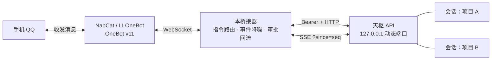

# 天枢 ⇄ QQ 桥

把[天枢（Tianshu）](https://tianshu.ai) 会话接到 QQ：**项目进展推到手机，手机指令回灌到对应会话**。不用再坐在电脑前等下一轮。

零运行时依赖，只需要 Node ≥ 22 和一个 QQ 协议端。

> ⚠️ **先读这个**：这个桥等于把你的机器执行权限挂到了 QQ 上。谁能给机器人发消息，谁就能在你的机器上让 AI 执行命令。**部署前必读 SECURITY.md**，白名单必须填。

## 目录

- [它是怎么工作的](#它是怎么工作的)
- [三步跑起来](#三步跑起来)
- [指令表](#指令表)
- [带图片下指令](#带图片下指令)
- [多会话并行 + 引用路由](#多会话并行--引用路由)
- [配置项](#配置项)
- [天枢 API 速查](#天枢-api-速查)
- [测试](#测试)
- [故障排查](#故障排查)
- [已知局限](#已知局限)
- [License](#license)

## 它是怎么工作的

天枢桌面端本身就跑着一个本地 HTTP + SSE 服务（它自带的手机端 mobile-web 用的就是这条通路）。这个桥不逆向、不魔改天枢，只是作为另一个客户端接上去：



- **下行**（天枢 → QQ）：每个被绑定的会话开一条 SSE 长连接，事件降噪后推给你。游标持久化，断线/重启都从上次的 `lastSeq` 续上，不丢事件。
- **上行**（QQ → 天枢）：以 `/` 或 `#` 开头的走控制指令；其它文本直接发给当前绑定的会话——会话正在跑就 `steer`（插话），空闲就 `prompt`（新起一轮）。这个判断由天枢自己返回的 409 `code=idle` 兜底校正。

## 三步跑起来

### 0. 前置

- **天枢桌面端**在运行（桥会读它写的 `server-info.json` 拿 port/token）
- **Node ≥ 22**
- 一个**小号 QQ**（非官方协议端有风控风险，别用主号）

### 1. 装 QQ 协议端（NapCat）

> ⚠️ **上游已停止维护**：NapCat 官方仓库（`NapNeko/NapCatQQ`）已于 2026-11 宣布 "Ending"，
> 代码和 Releases 都已清空。下面提供的是**社区备份镜像**，非官方，请自行评估风险。

你机器上要有 QQ NT，但还缺协议端。两种方式：

**方式 A：用一键安装脚本（推荐，Windows）**

```bat
scripts\install-napcat.bat
```

脚本会：检查环境 → 从社区镜像下载 `NapCat.Framework.zip` → 校验 → 解压 →
提示后续步骤。默认装到 `D:\NapCat`，可传参数改：

```bat
scripts\install-napcat.bat E:\Tools\NapCat
```

或用自有镜像：

```bat
set NAPCAT_MIRROR=https://your.mirror/NapCat.Framework.zip
scripts\install-napcat.bat
```

> 脚本**只下载不打包**，仓库里不含 NapCat 任何二进制。下载源是社区备份
> （当前为 [Creep-debug/NapCatQQ](https://github.com/Creep-debug/NapCatQQ/releases)），
> 非官方、无许可证声明，本项目不对其做任何担保。

**方式 B：手动下载**

从社区镜像 [Creep-debug/NapCatQQ](https://github.com/Creep-debug/NapCatQQ/releases)
下载 `NapCat.Framework.zip`，解压后双击 `napiLoader.bat`，用手机 QQ 扫码登录一个**小号**。

解压位置随意。`napiLoader.bat` 会从注册表自动找到 QQ 安装路径，无需手工填。

登录后进 NapCat 的 WebUI（默认 `http://127.0.0.1:6099`，token 在同目录 `config\webui.json`），到「网络配置 → 新建 → WebSocket服务器」：

| 字段 | 值 |
|---|---|
| 启用 | 打开 |
| 名称 | `tianshu-bridge`（随意） |
| Host | `127.0.0.1` |
| Port | `3001` |
| 消息格式 | `Array` 或 `String` 都行 |
| Token | 留着，抄进桥接配置（见下） |

保存后端口应立即监听，配置写入 `config\onebot11_<你的QQ号>.json`。

**用反向 WS 也可以**：NapCat 里选「WebSocket客户端」，URL 填 `ws://127.0.0.1:6700/onebot`，并把本项目 `onebot.mode` 改成 `reverse`。

### 2. 填配置

复制模板再改：

```bash
cp bridge.config.example.json bridge.config.json
```

**必须填两项**（不填白名单，桥会拒绝处理任何消息）：

```json
{
  "onebot": { "accessToken": "NapCat WebUI 里那个 Token 原样抄进来" },
  "qq": { "allowUsers": ["你的QQ号"] }
}
```

`allowUsers` 留空 = 拒绝所有人。真实配置含密钥，已在 `.gitignore` 里，不会入库。

天枢的端口和令牌由桌面端每次启动重写。`tianshu.serverInfoPath` 留空时桥会自动探测常见位置；探测不到就在配置里显式写上，例如：

```json
{ "tianshu": { "serverInfoPath": "D:/tianshu/TianshuData/.rivet/server-info.json" } }
```

天枢重启换了令牌，桥会自愈重连。

### 3. 启动

```bash
node src/index.js
```

或者一条命令走完全流程（自动拉起 NapCat → 等你扫码 → 确认 QQ 真上线后才起桥）：

```bash
npm run launch
```

`launch.js` 的常用选项：

| 选项 | 作用 |
|---|---|
| `--kill-qq` | 检测到「裸 QQ 进程」（QQ 自己开着、没被 NapCat 注入）时先结束它，再重新拉起。否则会停下提示你手动关 QQ |
| `--no-napcat` | 只等待，不自动拉起 NapCat（NapCat 你自己起） |
| `--timeout <秒>` | 等 QQ 上线的上限，默认 1200 |
| `--interval <秒>` | 轮询间隔，默认 3 |

> **为什么有时要 `--kill-qq`**：QQ 是单实例，如果它开机自启先占住了、没走 NapCat 注入，桥会提示「检测到裸 QQ 进程」。加 `--kill-qq` 让它结束裸 QQ 后由 NapCat 重新拉起并注入。

### 开机自启（可选）

仓库带了一个 `autostart/` 目录：

- `autostart/napcat-autostart.bat`：静默跑 `launch.js`，可加进 Windows 开机自启（注册表 `HKCU\...\Run`）。
- `autostart/restore-qq-autostart.bat`：恢复 QQ 自己的开机自启（如果你之前禁用了它）。

启用自启前，**先禁用 QQ 自己的开机自启**（否则开机 QQ 抢先占住单实例，NapCat 注入会落空）。自启脚本执行结果写在 `autostart/last-run.log`，出问题先看它。

> ⚠️ NapCat 只负责注入，登录哪个号由 QQ 的「上次登录态」决定。要开机就自动登对号，关机前确保 QQ 停在你想要的那个号上。

正常的启动日志长这样：

```
天枢 ⇄ QQ 桥启动
OneBot 模式：forward → ws://127.0.0.1:3001
[onebot] 已连上 NapCat（正向 WS）
[onebot] 登录账号：bot（123456789）
就绪。在 QQ 里发 /help 试试。
```

然后在 QQ 里发 `/help`。每次收到消息都会留下痕迹：

```
05:44:00 收到 private:987654321（你的昵称）：/list
05:44:00   → 指令已处理：/list
```

### 注意：你需要两个 QQ 号

机器人登录的号（上面扫码的那个）**不能给自己发私聊消息**——QQ 不支持。所以要用你自己的另一个号去给它发指令。

只有一个号时的两条路：

- 建一个群把机器人拉进去，群里 `@机器人` 或直接发 `/` 指令（群消息会全部推给 bot，自己发的也能收到）；
- 或者把机器人号加为好友后再发（陌生人消息可能被 QQ 拦掉，收不到就互加好友）。

## 指令表

| 指令 | 作用 |
|---|---|
| `/list` | 列出最近 12 个会话（`→` 默认会话，`*` 关注中） |
| `/use <编号\|id后8位\|标题片段>` | 设定默认会话：不引用时发到这里 |
| `/watch <编号>` | 关注一个会话，它的动静都推到 QQ |
| `/watch all` | 关注所有未归档会话（多开并行的入口） |
| `/unwatch <编号\|all>` | 取消关注 |
| `/watch` | 看当前关注了哪些 |
| `/unbind` | 解除默认会话 |
| `/status` | 当前默认会话的状态、模型、上下文占用、游标 |
| `/tail [n]` | 最近 n 条事件摘要（默认 8） |
| `/new <目录> <指令>` | 在指定目录新建会话并立刻开跑 |
| `/abort` | 中止默认会话 |
| `/mute` `/unmute` | 开关本聊天的进展推送 |
| `/approve [总是]` `/deny` | 批准/拒绝最近一次待审批 |
| `/plan on\|off` | 切换计划模式 |
| `/help` | 指令表 |

不带斜杠的文字会直接发给当前默认会话。

## 带图片下指令

直接发图片 + 一段文字（可带可不带文字），桥会把图片转成天枢的 `images` 载荷一起送过去：

- **本地文件优先**：NapCat 与桥在同一台机器上，图片段的 `file` 路径直接读，不依赖 QQ 图床
- **URL 兜底**：本地读不到时才走 `url` 下载，可用 `push.imageUrlFallback: false` 关掉
- 最多 **4 张**，单张 ≤ **10MB**，支持 png / jpeg / webp / gif（天枢服务端限制）
- 单张失败只提示、不丢整条指令

天枢原生支持多模态，图片是真正送给模型看的，不是 OCR 转文字。

## 多会话并行 + 引用路由

同时开多个天枢会话时，**每个会话的动静都会推到 QQ**，每条推送带会话标签：

```
[项目A|7a3f] ▸ bash: npm test
[项目B|b60d] ✓ 回合结束（in 1203 / out 88 tokens）
[项目C|9400] 我先确认两件事再动手…
```

想知道某条推送是哪个会话的、要针对它回话，**直接长按引用那条消息再回复**即可：

- 引用 `[项目A|7a3f]` 那条 → 你的话只发给项目A那个会话
- 引用 `[项目B|b60d]` 那条 → 只发给项目B那个会话

桥会在发出每条推送时记下 QQ 的 `message_id` 与来源会话的对应关系（持久化，重启不丢，保留最近 800 条）。收到带引用的回复时，按这个索引精确路由；如果引用的消息不在索引里（太旧被裁剪、或来自别的客户端），会回退到默认会话并提示。

不引用直接发 → 发给 `/use` 设的默认会话。

「有消息就转发」的送达范围：优先发给显式 `/watch` 过的聊天；没有显式关注时，发给所有跟机器人说过话的聊天。想彻底关掉自动转发，把 `push.autoForward` 设为 `false`。

## 配置项

| 键 | 说明 |
|---|---|
| `tianshu.serverInfoPath` | 天枢写的服务信息文件（含 port/token）。留空自动探测 |
| `onebot.mode` | `forward`（连 NapCat）或 `reverse`（等 NapCat 连） |
| `onebot.accessToken` | NapCat WebUI 里生成的 Token |
| `qq.allowUsers` | 私聊白名单。**留空 = 全部拒绝** |
| `qq.allowGroups` | 群白名单。留空 = 群消息全部拒绝 |
| `onebot.napcatRoot` | NapCat 根目录（含 `napimain.exe`），给 `npm run launch` 用。留空自动探测 |
| `onebot.qqPath` | QQ 可执行文件路径，给 `npm run launch` 用。留空自动探测 |
| `push.level` | `final`（默认）每轮结束只推最终结果｜`normal` 流式正文+工具调用+token｜`quiet` 最简｜`verbose` 再加阶段 |
| `push.maxChars` | 单条推送上限，超出按段落切 |
| `push.renderMarkdown` | 把 Markdown 渲染成图片再发（QQ 不渲染 Markdown） |
| `push.idleFlushMs` | 正文静默多久后强制推送 |
| `statePath` | 游标与绑定关系的持久化位置 |

## 天枢 API 速查

（本桥依赖的部分，全部经实测确认；`Authorization: Bearer <token>`）

```
GET    /sessions[?includeArchived=true]
POST   /sessions                       {prompt, cwd?, planMode?}
GET    /sessions/{id}
PATCH  /sessions/{id}                  {title}
DELETE /sessions/{id}                  归档
DELETE /sessions/{id}/permanent        永久删除
POST   /sessions/{id}/unarchive
POST   /sessions/{id}/prompt           {prompt}     空闲→新起一轮
POST   /sessions/{id}/steer            {text}       运行中插话（空闲时返回 409 code=idle）
POST   /sessions/{id}/abort
POST   /sessions/{id}/plan-mode        {state}
POST   /sessions/{id}/effort           {effort}
POST   /sessions/{id}/approvals/{aid}/answer   {decision, remember?}
POST   /sessions/{id}/plans/{pid}/approve|reject
GET    /sessions/{id}/events?since=N
GET    /sessions/{id}/stream?since=N   SSE
GET    /sessions/{id}/artifacts[/{aid}]
GET    /sessions/search?q=
GET    /remote/info
```

事件类型：`text_delta`、`thinking_delta`、`tool_use`、`tool_result`、`tool_input_progress`、`turn_complete`、`phase`、`status`、`context_budget`、`hook_result`、`goal_state`、`domain_usage`。

## 测试

```bash
npm test
```

分层：

- `unit.test.js` — 切块、工具摘要、事件降噪、游标持久化、白名单鉴权
- `attachments.test.js` — 图片段解析、格式嗅探、本地优先/URL 兜底
- `markdown.test.js` / `mermaid.test.js` — Markdown 转换、图表渲染
- `question.test.js` — 分支问答格式化/解析/持久化
- `routing.test.js` — 引用路由、消息索引、关注列表
- `launch.test.js` — 一键启动的探测与判定逻辑
- `delivery.test.js` — 推送交付顺序与切块
- `integration.test.js` — mock NapCat + 真天枢只读（天枢没运行时自动跳过）

## 故障排查

| 现象 | 原因 |
|---|---|
| `读不到天枢服务信息` | 天枢桌面端没开，或 `tianshu.serverInfoPath` 不对 |
| `OneBot 未连接` | NapCat 没启动 / 端口不对 / 模式下反了 |
| 发了消息没反应 | `qq.allowUsers` 里没你的号（日志会打印「拒绝」） |
| 启动即「白名单为空」 | 按提示填 `qq.allowUsers` |
| 推送重复 | 检查 `state.json` 是否可写（游标存不下来） |
| QQ 号被风控下线 | 非官方协议端的固有风险，换小号或降低发送频率 |
| `NapCat 已在运行，但 WS 服务器没监听` | 当前登录的号没配 WS 服务器，去 WebUI 补一个 |

## 已知局限

1. **没有内置开机自启**。需要常驻就自己配计划任务 / systemd（Windows 可参考上文「开机自启」用 `autostart/` 目录里的 bat）。
2. **mermaid 之外没做代码高亮**。代码块有背景和等宽字体，但没有 token 着色。
3. **渲染失败降级为纯文本**（保留原文但丢样式）。Markdown 渲染依赖系统 Chrome/Edge 与 `playwright-core`。
4. **分支问答的回答走普通 prompt**，不是专用接口——天枢只有 `interventions/:id/answer`（管 approve/deny），没有「回答问题」路由。
5. **引用索引上限 800 条**，太旧的引用会回退到默认会话。
6. **群聊要 `/watch` 或 @机器人**，否则闲聊不触发。
7. `vendor/mermaid.min.js` 约 2.5MB 在仓库里，克隆偏大但保证离线可用。

## License

[MIT](LICENSE)。

使用本项目需要自备第三方 QQ 协议端（NapCat / LLOneBot 等），本项目不包含、不分发它们。
这类非官方协议端违反 QQ 用户协议，存在账号被风控或封禁的风险，**请使用小号并自担风险**。
